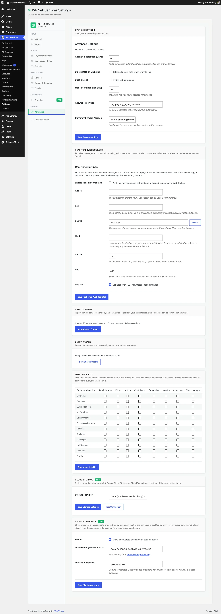

# Setting Up Cloud Storage **[PRO]**

Connect your marketplace to Amazon S3, Google Cloud Storage, or DigitalOcean Spaces for scalable, fast file delivery.

---

## Before You Start

You will need:
- WP Sell Services Pro active
- An account with your chosen cloud provider
- Access credentials (API keys or service account) from the provider

---

## Amazon S3

### Step 1: Create an S3 Bucket

1. Sign in to the [AWS Console](https://aws.amazon.com/console/)
2. Go to **S3** and click **Create Bucket**
3. Choose a bucket name (e.g., "yoursite-deliveries") and region
4. Keep the default security settings (block public access)
5. Click **Create Bucket**

### Step 2: Create Access Keys

1. Go to **IAM > Users > Add User**
2. Create a user with programmatic access
3. Attach the **AmazonS3FullAccess** policy (or a custom policy limited to your bucket)
4. Save the **Access key ID** and **Secret access key**

### Step 3: Configure in WP Sell Services

1. Go to **Sell Services > Settings > Integrations**
2. Select **Amazon S3** as the provider
3. Enter your Access Key ID, Secret Access Key, bucket name, and region
4. Click **Test connection** to verify
5. Save Changes

---

## Google Cloud Storage

### Step 1: Create a Storage Bucket

1. Sign in to the [Google Cloud Console](https://console.cloud.google.com/)
2. Go to **Cloud Storage > Buckets > Create**
3. Choose a bucket name and location
4. Set access control to "Uniform"
5. Click **Create**

### Step 2: Create a Service Account

1. Go to **IAM & Admin > Service Accounts > Create Service Account**
2. Give it a name like "wpss-storage"
3. Grant the **Storage Object Admin** role
4. Create a JSON key and download it

### Step 3: Configure in WP Sell Services

1. Go to **Sell Services > Settings > Integrations**
2. Select **Google Cloud Storage** as the provider
3. Upload or paste your service account JSON key
4. Enter your bucket name
5. Click **Test connection** to verify
6. Save Changes

---

## DigitalOcean Spaces

### Step 1: Create a Space

1. Sign in to the [DigitalOcean Control Panel](https://cloud.digitalocean.com/)
2. Go to **Spaces** and click **Create a Space**
3. Choose a datacenter region
4. Give it a name (e.g., "yoursite-deliveries")
5. Click **Create a Space**

### Step 2: Generate API Keys

1. Go to **API > Spaces Keys > Generate New Key**
2. Save the **Key** and **Secret**

### Step 3: Configure in WP Sell Services

1. Go to **Sell Services > Settings > Integrations**
2. Select **DigitalOcean Spaces** as the provider
3. Enter your Key, Secret, Space name, and region
4. Click **Test connection** to verify
5. Save Changes

---

## After Setup

**Deliveries go to your bucket once a provider is active.** A delivery or
requirement file uploads to the provider you selected, and the local copy is
removed afterwards so you are not paying for the bucket and the disk both.

Buyers and vendors never get a bucket URL. They download through a
permission-checked link on the order, which hands out a short-lived signed URL
after confirming they are a party to that order.

### Test It

Upload a delivery on a real order, then check your bucket: the file appears
under `wpss/{order_id}/delivery/`, named `{file id}-{original name}`. That is the end-to-end check.

**Test connection** on the settings card writes a small test file, downloads it
through a signed link exactly as a buyer would, and deletes it. It fails if the
credentials, region or permissions would stop buyers downloading, which is the
faster check when you are first setting up.

### Fallback Behavior

If an upload to the bucket fails (bad credentials, network error, outage), the
file stays on your server and is served from there, so a delivery is never
lost. The failure is written to the plugin log.

Files larger than a quarter of PHP's `memory_limit` also stay on your server,
because uploading them would exhaust memory (on a 256M limit, files over 64 MB).
Raise `memory_limit` to send bigger files to the bucket, or change the cap with
the `wpss_cloud_upload_max_bytes` filter.

### Changing Bucket or Region

Each file uploaded since version 2.0.0 remembers its bucket and region, so a
later change leaves those files downloadable, as long as the old bucket and its
credentials still exist. Files uploaded before 2.0.0 remember only the provider
and are read from its current bucket and region: if you change either, copy
those files to the new bucket first. Saving the settings warns you when such
files exist.

---

## Choosing a Provider

| Factor | Amazon S3 | Google Cloud | DigitalOcean Spaces |
|--------|-----------|-------------|-------------------|
| Pricing | Pay per use | Pay per use | $5/month flat start |
| Ease of setup | Moderate | Moderate | Simple |
| CDN included | Extra (CloudFront) | Extra (Cloud CDN) | Included |
| Best for | Large, global marketplaces | Asia-Pacific focus | Small to medium marketplaces |
| S3-compatible | Yes (native) | No | Yes |

---

## Troubleshooting

**"Connection failed" when testing?**
Double-check your credentials (access key, secret, bucket name, region). Make sure the bucket exists and the credentials have permission to read and write to it.

**Files not uploading to cloud?**
Check that cloud storage is selected as the active provider in settings. Also verify your server can make outbound HTTPS connections (some hosting providers block them).

**Slow downloads?**
Enable the CDN option for your provider. S3 uses CloudFront, GCS uses Cloud CDN, and DigitalOcean Spaces includes a CDN by default.
