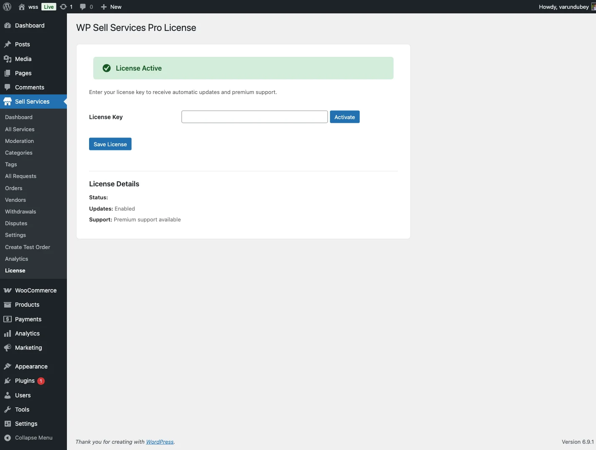

# License Activation & Updates [PRO]

WP Sell Services Pro uses a license key for automatic updates and priority
support. Every Pro feature works with or without it.

## Activate your license

1. Buy Pro. Your key is in the purchase receipt email and on your account page at [wbcomdesigns.com](https://wbcomdesigns.com).
2. Install and activate the free **WP Sell Services** plugin first, then Pro.
3. In WordPress, go to **Sell Services > License**.
4. Paste the key and click **Activate license**.

The License screen is its own menu item under **Sell Services** -- not a tab
inside Settings.

Once the status reads active, your site receives Pro updates in
**Dashboard > Updates** like any other plugin.

## What the license controls

The license controls **plugin updates and support only**. It never switches a
feature off.

- **Active:** Pro updates arrive in **Dashboard > Updates**, and you get priority support.
- **Missing, invalid or expired:** every Pro feature keeps running - Stripe Connect,
  payouts, Razorpay, the store integrations, tiered commission, vendor
  subscriptions, white label, cloud storage, analytics and the raised service
  limits. You stop receiving updates and support until you renew, and a notice
  on the admin screens says so.

Nothing changes for your vendors or buyers when a license lapses.

## Checking status

The License screen shows the current state and, where the store provides it, the
expiry date. A key marked `lifetime` never expires.

If activation fails, the screen reports the reason returned by the store -- an
exhausted site limit and a mistyped key produce different messages, so read it
before retrying.

> **"Active" with an empty key field is normal after an upgrade.** Sites licensed
> on an older version of Pro carry a legacy activation flag, and the plugin
> honours it so that upgrading never silently switches Pro off. The key box
> renders empty because the current option has not been written yet -- Pro is
> genuinely active. Paste your key and activate again whenever convenient to move
> the site onto the current record.

## Moving to a new site

Deactivate on the old site first, then activate on the new one:

1. On the old site, go to **Sell Services > License** and click **Deactivate license**. This frees the site slot.
2. On the new site, paste the same key and click **Activate license**.

If you no longer have access to the old site -- it was deleted, or a client took
it over -- contact support and we will free the slot for you.

### Site limits

How many sites one key covers depends on the plan you bought: typically a single
site, a small bundle for developers, or unlimited for agencies. Your account page
lists the limit and which sites are using it.

Staging and development copies count as sites unless your host serves them on a
recognised staging domain. If you are unsure, deactivate before cloning.

## Troubleshooting

| Problem | What to do |
|---------|-----------|
| Pro features missing after activating the plugin | Check that the free **WP Sell Services** plugin is active and at the version Pro requires. |
| "License key is invalid" | Re-copy the key from your account page -- a trailing space is the usual cause. |
| "No activations left" | Deactivate the key on a site you no longer use, or upgrade your plan. |
| Status active but no updates arrive | Your host may block outgoing requests to `wbcomdesigns.com`. Ask them to allow it. |

## Related

- [Installation & Requirements](installation.md)
- [Free vs Pro Feature Comparison](free-vs-pro.md)
- [Paying Your Vendors](../earnings-wallet/vendor-payouts.md)
