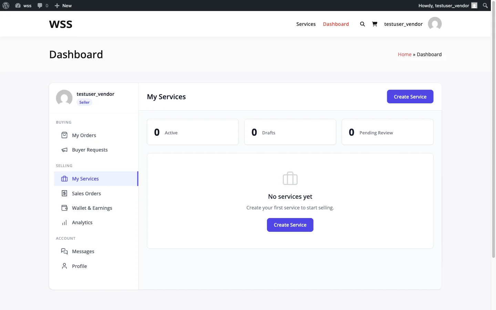

# Managing Your Services: Edit, Pause, and Delete

After publishing a service, you can update it, temporarily hide it, or remove it entirely. This guide covers how each action works and what to expect.

## Accessing Your Services

Go to your **Dashboard** and click **My Services** in the sidebar. You will see a list of all your services with their:

- **Title** and featured image
- **Status** -- Published, Draft, Pending, or Suspended
- **Price range** -- Starting from the lowest package price
- **Total orders** and **active orders**
- **Average rating**

---

## Editing a Service

Click **Edit** next to any service to open the service editor. You can update:

- **Title and description**
- **Category**
- **Pricing packages** -- Change prices, delivery times, revisions, and features
- **Add-ons** -- Add, remove, or reprice extras
- **Gallery images and videos**
- **Requirements and FAQs**
- **Tags**

### What Happens After Editing

The behavior depends on whether the marketplace requires service moderation:

| Moderation Setting | What Happens |
|--------------------|-------------|
| **Moderation off** | Changes go live immediately |
| **Moderation on** | Your service is set to "Pending" and goes back into the approval queue. It is temporarily hidden from the marketplace until an admin approves it. |

**Tip:** If moderation is enabled, avoid making frequent small edits to a published service. Batch your changes and submit them all at once to minimize time spent waiting for re-approval.

### Active Orders Are Not Affected

Editing a service does not change any orders already in progress. Existing orders keep their original package terms (price, delivery time, revisions). Only new orders use the updated details.

---

## Pausing a Service

Pausing stops new orders without taking the service down. It stays published: buyers can still find it in search and the catalog, open its page and save it to favorites. The order buttons are disabled with the note "This service is paused and not accepting new orders right now." It keeps its settings, reviews, order history and page address.

While a service is paused, its page asks search engines not to index it and it is left out of the sitemap, so a long pause can cost search ranking. Resume it as soon as you can take orders again.

### How to Pause

1. Go to **Dashboard > My Services**
2. Click **Pause** on the service
3. The badge on the card changes to **Paused** and the button to **Resume**

### How to Resume

1. Go to **Dashboard > My Services**
2. Click **Resume** on the paused service

Resuming takes effect straight away. It does not go back through moderation, because the service never left the published state.

A site admin can pause or resume any service from the **Status** field on the service's edit screen in wp-admin. It is the same setting.

To take a service off the marketplace entirely, open it in the editor and save it as a draft. A draft is not listed, and publishing it again counts against your service limit and goes through moderation if that is on.

### When to Pause

- **Taking time off** -- Use [Vacation Mode](../vendor-system/vacation-mode.md) instead if you want to pause all services at once
- **Updating content** -- Pause while making major changes, then reactivate when ready
- **Seasonal services** -- Hide services you only offer at certain times of the year
- **Too many active orders** -- Temporarily stop new orders while you catch up on existing work

### What Happens to Active Orders

Pausing a service does not affect orders already in progress. Existing buyers can still communicate with you, receive deliveries, and go through the normal order lifecycle. Only new purchases are prevented.

---

## Deleting a Service

Deleting permanently removes a service from the marketplace.

### Before You Delete

You **cannot delete a service that has active orders**. You must first:

1. Complete or cancel all active orders
2. Wait for any pending deliveries or disputes to resolve

### How to Delete

1. Go to **Dashboard > My Services**
2. Click **Delete** next to the service
3. Confirm the deletion

### What Gets Removed

- The service listing and all its content
- Package definitions and add-ons
- Gallery images associated with the service
- FAQs and requirements

### What Is Preserved

- **Completed order records** -- All past orders, conversations, and deliveries remain in the system
- **Reviews** -- Existing reviews are preserved
- **Your earnings** -- All commission records stay intact

### When to Delete vs Pause

| Action | Use When |
|--------|----------|
| **Pause** | You might offer this service again in the future |
| **Delete** | You will never offer this service again and want a clean slate |

If you are unsure, pause instead. You can always delete later, but you cannot recover a deleted service.

---

## Service Statuses Reference

| Status | Visible to Buyers | Can Be Purchased | How to Get Here |
|--------|-------------------|------------------|----------------|
| **Published** | Yes | Yes | Approved by admin (or moderation off) |
| **Paused** | Yes | No | You clicked Pause, or an admin set the service to Paused |
| **Draft** | No | No | New service not yet submitted, or saved as a draft |
| **Pending review** | No | No | Submitted for moderation, awaiting admin approval |
| **Rejected** | No | No | An admin rejected it in moderation; edit it and resubmit |

---

## Tips for Managing Services

- **Keep descriptions current** -- Outdated descriptions lead to mismatched expectations and revision requests
- **Adjust pricing gradually** -- Large sudden price changes can confuse returning buyers
- **Monitor your reviews** -- If you see recurring feedback, update your service or packages to address it
- **Use pause strategically** -- Better to pause than to take orders you cannot deliver on time
- **Delete sparingly** -- A service with strong reviews and order history is an asset; pause it rather than delete it

---

## Related Guides

- [Service Creation Wizard](service-wizard.md) -- How to create a service from scratch
- [Pricing Packages](pricing-packages.md) -- Setting up Basic, Standard, and Premium tiers
- [Publishing and Moderation](publishing-moderation.md) -- The approval process
- [Vacation Mode](../vendor-system/vacation-mode.md) -- Pause all services at once
- [Vendor Dashboard](../vendor-system/vendor-dashboard.md) -- Full dashboard overview
