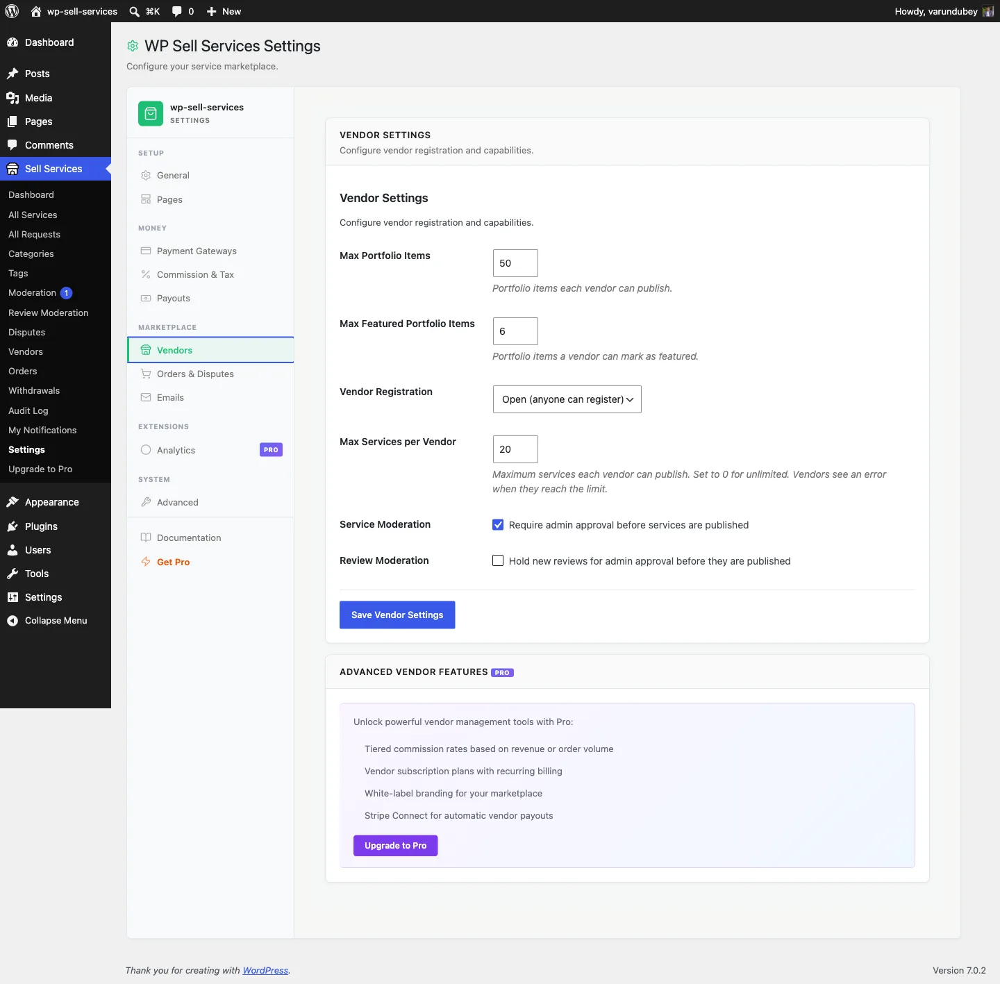

# Vendor Settings (Admin)

These settings control how vendors join your marketplace, how many services they can create, and whether their services need your approval before going live. Find them at **Sell Services > Settings > Vendor Settings**.

## Vendor Registration Mode

**Default: Open**

Choose how vendors can join your marketplace:

| Mode | What Happens | Best For |
|------|-------------|----------|
| **Open** | Any logged-in member can start selling immediately | Growing marketplaces, community platforms |
| **Requires Approval** | Users submit applications; you approve or reject them | Curated marketplaces, quality control |
| **Closed** | Only you can create vendor accounts | Invite-only platforms, soft launches |

### How Approval Works

When set to "Requires Approval":

1. A user submits the vendor registration form.
2. You receive a notification.
3. Go to **Sell Services > Vendors** and filter by "Pending" status.
4. Review the application and click **Approve** or **Reject**.
5. The applicant gets an email with the result.

Try to respond within 24-48 hours. Slow approvals can discourage quality vendors from joining.

### Manual Vendor Creation (Closed Mode)

When registration is closed, you create vendor accounts manually:

1. Go to **Users > Add New** and create a WordPress user account.
2. Assign the vendor role.
3. The user can now access vendor features immediately.

## Max Services Per Vendor

**Default: 20**

This limits how many active services each vendor can create. Set it to 0 for unlimited.

Keeping a reasonable limit encourages vendors to focus on quality over quantity. You can always increase it for top performers.

## Require Verification

**Default: Disabled**

When enabled, new vendors start with "Pending" status and cannot create services until you verify their identity. You review their information and manually activate their account.

This adds an extra quality gate -- vendors must be verified before they can list anything on your marketplace.

## Require Service Moderation

**Default: Disabled**

When it is off, new services publish immediately. When enabled, every new service a vendor creates goes into "Pending Review" status instead of being published immediately. You review each service and approve or reject it. Only administrators can moderate.

To review pending services, go to **Sell Services > Moderation** - the queue carries a pending count in the menu. To browse everything else, go to **Sell Services > All Services** and filter by status.

This is useful for maintaining marketplace quality, especially in the early days. As you build trust with your top vendors, you might consider disabling this to speed things up.

## Re-review Live Edits

**Default: Disabled**

Controls what happens when a vendor edits a service that is already live. When it is off, an approved service stays live while the vendor edits it. When it is on, every edit takes the service offline until you approve it again. New services always wait for approval when Require Service Moderation is on.

## Vendor Application Questions

**Default: Disabled**

When it is off, a member becomes a vendor with one click on the Start selling panel. When it is on, the panel first asks for a tagline and a short description, and you see both on the Vendors screen when you approve the application.

## Verify Email Before Selling

**Default: Disabled**

Applies to members who sign up through the plugin's own sign-up form. When it is off, sign-up works as before. When it is on, new members get a confirmation link by email, and the Start selling button asks them to use it before they can become a vendor. Members who joined earlier, or another way, are not affected.

## Sign-up Notice

**Default: Disabled**

Emails the site admin when someone signs up through the plugin. It is the same "New user registration" email WordPress sends for its own sign-up form.

## Suspended Vendors and Earnings

**Default: Disabled**

Suspending a vendor stops new work. This setting decides whether it also holds money the vendor has already earned.

- **Off:** a suspended vendor keeps Sales Orders only. Money already earned is held until you reactivate them or pay it by hand.
- **On:** a suspended vendor can still see their balance, request a withdrawal and update payout details. You still approve every withdrawal.

An account-level suspension or ban is never relaxed by this setting.

## Registration Form Fields

The vendor registration form collects:

- **Display Name** -- Their public vendor name.
- **Tagline** -- A professional one-liner.
- **Bio** -- Their background and experience.
- **Skills** -- Areas of expertise.
- **Terms Agreement** -- They must accept your marketplace terms.

## Admin Vendor Management

From **Sell Services > Vendors**, you can manage all vendors on your marketplace:

- **View Profiles** -- See complete vendor information and statistics.
- **Approve or Reject** -- For pending applications.
- **Suspend** -- Temporarily disable a vendor's account.
- **Delete** -- Remove a vendor account entirely.
- **Set Custom Commission** -- Override the global commission rate for specific vendors.

## Recommended Approaches

**For a brand-new marketplace:** Start with "Requires Approval" and "Require Service Moderation" both enabled. This lets you control quality as you build your initial vendor base. Once you have a solid group of trusted vendors, you can relax these settings.

**For a growing marketplace:** Switch to "Open" registration and disable service moderation to reduce friction. Use vendor levels to naturally incentivize quality.

**For a premium marketplace:** Keep approval required but disable service moderation for Top Rated and Pro Vendor vendors (the vendor level system handles quality control at that point).

## Related Documentation

- [Becoming a Vendor](becoming-a-vendor.md)
- [Vendor Dashboard](vendor-dashboard.md)
- [Vendor Levels](seller-levels.md)
